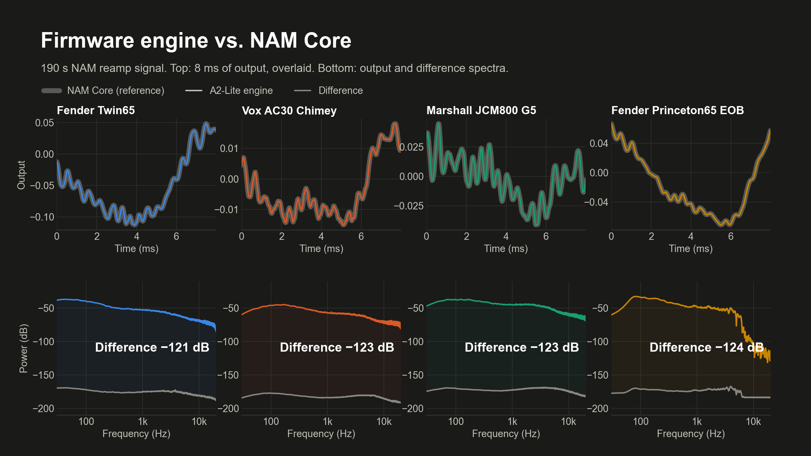
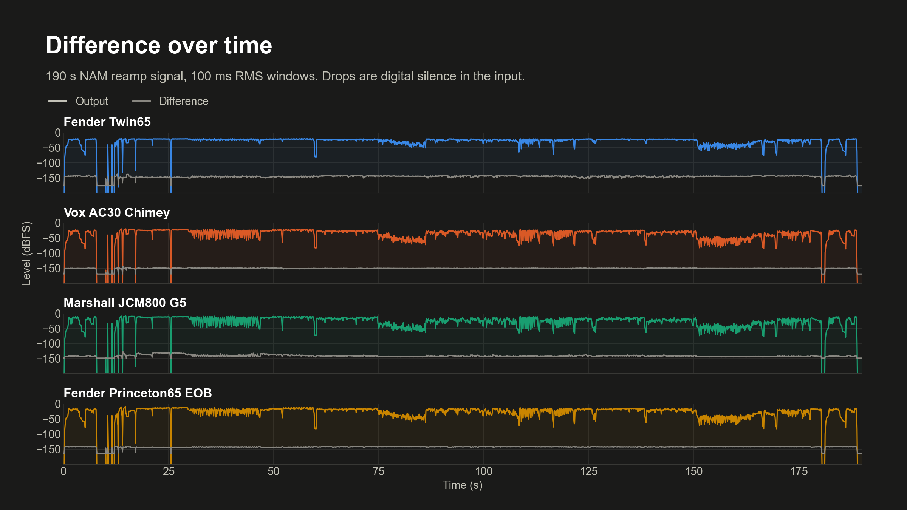
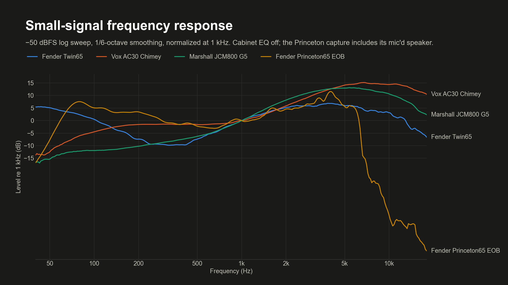
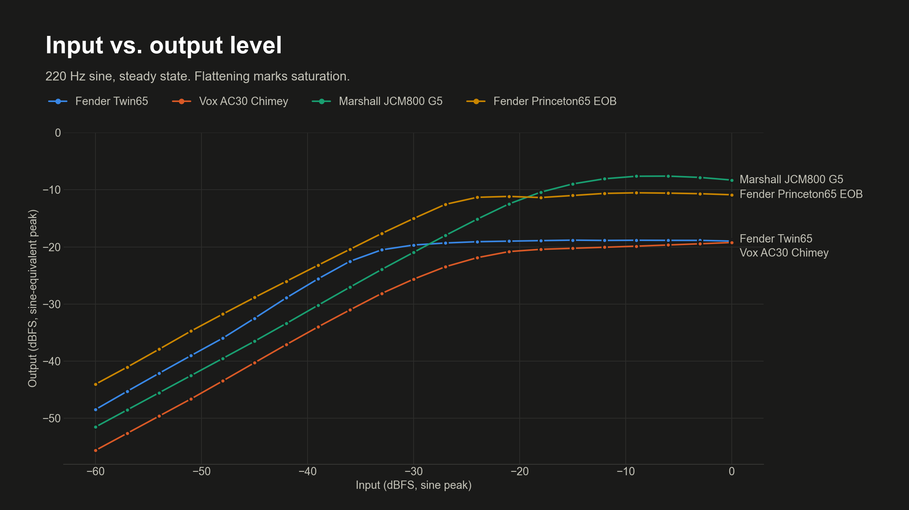
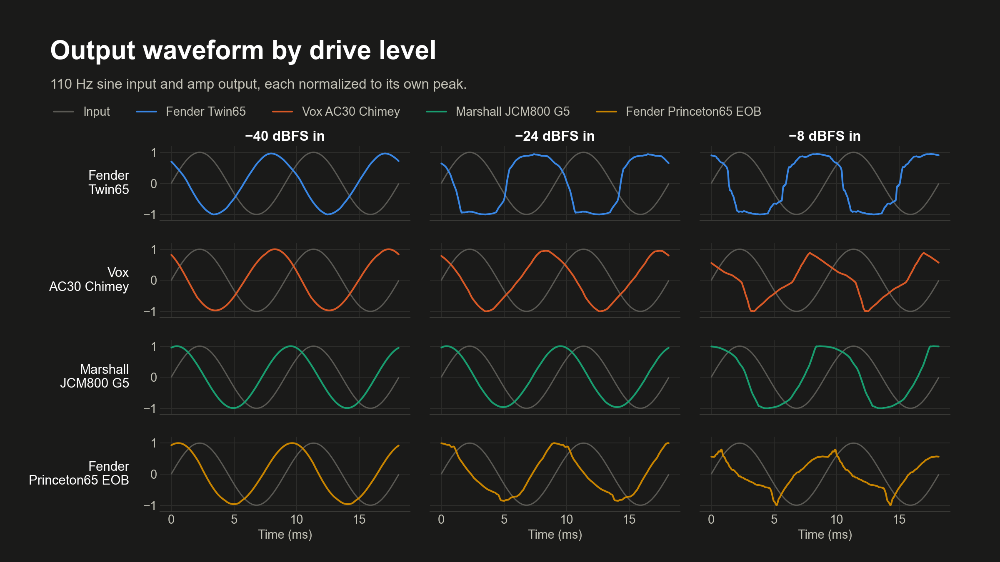
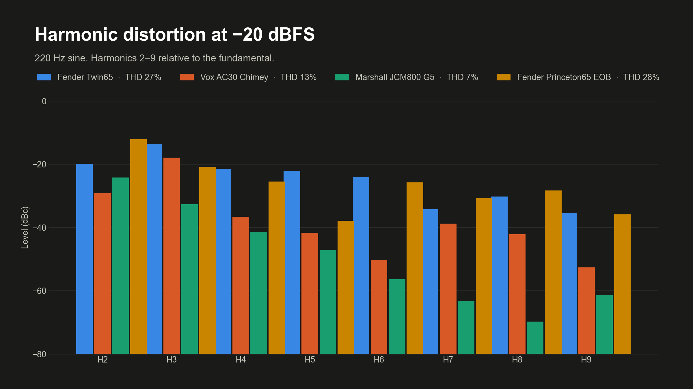
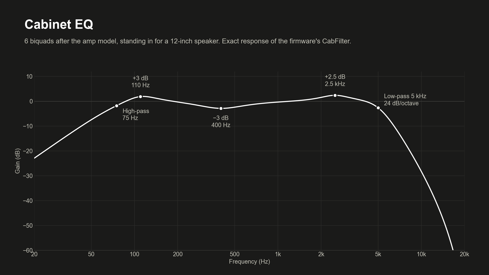
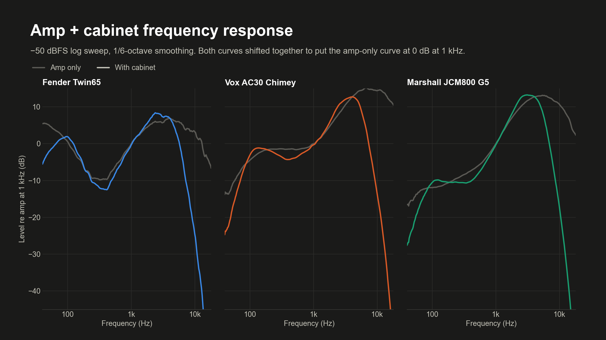
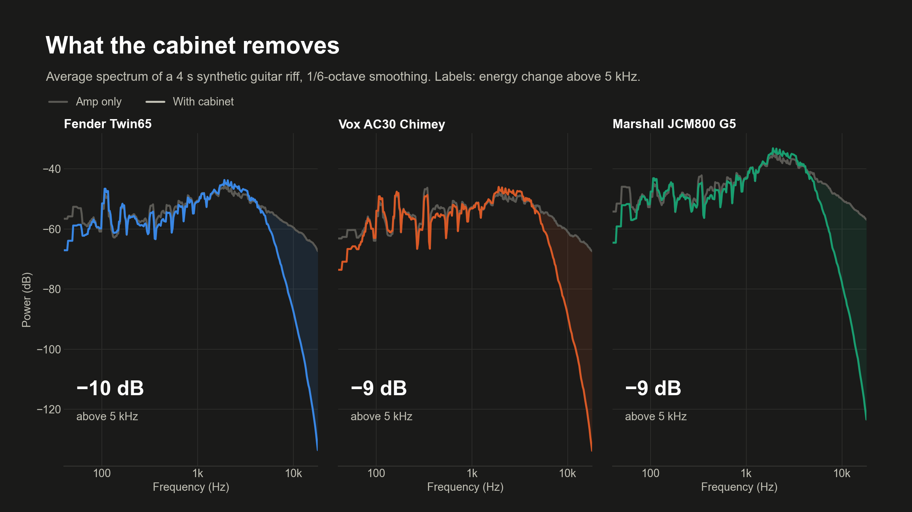
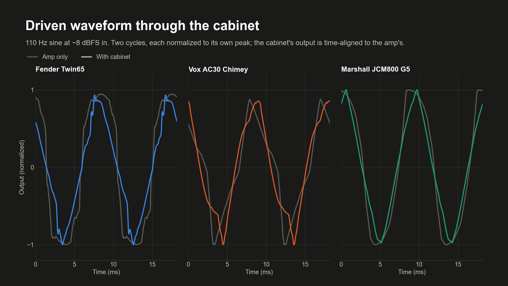

# NAM Seed3

Neural amp modeling on the Daisy Seed3 using libDaisy, with four A2-Lite models:
Fender '65 Twin Reverb, Vox AC30 Chimey, Marshall JCM800 (gain 5), and
Fender '65 Princeton Reverb (edge of breakup, SM57).

This firmware is one part of a capstone project, a portable touchscreen practice
guitar amp. The hardware it runs on is the carrier board in
[seed3-carrier-board](https://github.com/B1narySolutions/seed3-carrier-board).
Each repository keeps its own documentation alongside the work.

## Setup

On macOS, install [Homebrew](https://brew.sh) and Apple's Command Line Tools
(`xcode-select --install`). On Ubuntu the installer uses `apt-get`, and on Arch
it uses `pacman`; either way it requests `sudo` access when needed. Run from
the repository root:

```sh
bash scripts/install.sh
bash scripts/download_models.sh
make
```

`make install` runs the same installer, and `make download-models` runs the
download script. It installs the ARM compiler and DFU
uploader, then fetches pinned versions of libDaisy and NAM Core. The download script saves the four
Tone3000 models to Git-ignored `models/local/`. The build embeds their weights
in the firmware. On Linux, the installer also installs the build and download
prerequisites, including the ARM C/C++ libraries, Python 3 and `screen`, and adds
a udev rule so `make upload` and `make monitor` can reach the Seed without root.

## Upload and play

```sh
make upload
make monitor
```

If this firmware is already running, `make upload` sends it `B` over USB
serial and it reboots into DFU mode on its own. Otherwise (first flash, other
firmware, or a hung board), hold **BOOT**, press and release **RESET**, then
release **BOOT** to enter DFU mode before running `make upload`.

The firmware starts with Fender selected. Press a key in the serial monitor
to switch models or bypass; no Enter is needed:

| Key | Selection |
| --- | --- |
| `0` | Clean bypass (the mode it boots into) |
| `1` | Fender '65 Twin Reverb |
| `2` | Vox AC30 Chimey |
| `3` | Marshall JCM800 (gain 5) |
| `4` | Fender '65 Princeton Reverb (edge of breakup) |
| `C` | Cabinet EQ on or off (starts on; the Princeton always skips it) |
| `B` | Reboot into DFU mode for flashing |

Audio runs at 48 kHz, with the left input processed and sent to both outputs.
Switching models or toggling bypass or the cabinet briefly interrupts playback.

On the Seed3 carrier board, the volume and tone knobs act on the output, in
bypass too:

| Knob | Daisy pin | Effect |
| --- | --- | --- |
| Volume (RV2) | 22 (ADC 0, `A0`) | Output level on an audio taper: half way is about -18 dB, fully down is silent. |
| Tone (RV3) | 23 (ADC 1, `A1`) | 12 dB/octave low-pass whose corner sweeps from 400 Hz up to fully open, where the signal passes unchanged. |

Both are linear 10k pots wired as dividers from 3V3_A, read continuously by
the ADC. Changes glide with a 20 ms time constant, so turning a knob doesn't click. The
input level knob (RV1) is analog and never reaches the firmware.

The Twin, AC30 and JCM800 models capture the amps alone, which sounds harsh
without a speaker. A fixed cabinet EQ after the model stands in for one: it
cuts below 75 Hz, adds a speaker resonance at 110 Hz and presence at 2.5 kHz,
scoops 400 Hz, and rolls off at 24 dB/octave above 5 kHz. Press `C` to
compare with the raw amp. Bypass skips the cabinet too. The Princeton capture
already includes its mic'd 10-inch speaker, so it always skips the cabinet EQ;
`C` still sets the choice for the other amps. It is an EQ, not a measured
cabinet impulse response, and hardware gain calibration is not implemented.

If multiple serial ports are connected, use `make monitor PORT=/dev/cu.usbmodem…`.
Exit the monitor with **Ctrl-A**, then **K**, then **Y**.

### Serial status

The firmware prints one status line per second:

```
--- NAM A2-Lite | 48-sample blocks @ 48 kHz | budget 1000 us/block | keys: 0=bypass 1=Twin65 2=AC30 3=JCM800 4=Princeton C=cab B=DFU ---
[active Fender Twin65          ]  cab on   avg  55% ( 552 us)  peak  56% ( 562 us)  headroom   438 us  blocks 1000  overruns 0
>>> bypass
[bypass -                      ]  cab -    avg   0% (   3 us)  peak   0% (   3 us)  headroom   997 us  blocks 1000  overruns 0
```

| Field | Meaning |
| --- | --- |
| `[mode amp]` | `active` with the running model, `bypass`, or `failed` if the model did not load (audio is bypassed). |
| `cab` | Whether the cabinet EQ is on; `amp` when the capture includes its own cabinet, so the EQ is skipped; `-` when no model is running. |
| `avg` | Mean audio-callback time over the last second, as a percentage of the block budget and in microseconds. |
| `peak` | Longest single callback over the last second. |
| `headroom` | Budget minus peak: how much slower the callback could get before an overrun. Negative means an overrun happened. |
| `blocks` | Callbacks in the last second (1000 at 48 samples per block and 48 kHz). |
| `overruns` | Callbacks that exceeded the budget in the last second. Lines with overruns are marked `<-- OVERRUN`. |

The header repeats every 20 lines, and `>>>` lines record model switches,
bypass, and cabinet toggles. A `>>> volume 75%  tone 100%` line gives the raw
knob readings (percent of full travel) at startup and after either knob moves
by 2% or more, checked once a second. Bypass skips the model and the cabinet (only the knobs act on the input), so the
load drops to a few microseconds; leaving bypass reloads the selected model.
All four models share one architecture and cost the same.

## Results

These figures are rendered on the host by `make viz`, from the same engine source
the firmware runs. The accuracy figures use NAM's standard reamp signal when it
is at `models/local/reamp_signal.wav`, and a synthetic guitar DI otherwise.

### Accuracy

The firmware engine matches upstream NAM Core to within float rounding: the
difference is 121–124 dB below the output for every amp.



The difference stays at that level across the whole 190 s reamp signal.



### The four amps

Small-signal frequency response of each capture, without the cabinet EQ. The
Princeton's steep roll-off above 6 kHz is its mic'd speaker.



Output level against input level. All four saturate well before full scale;
the Twin capture is cranked and breaks up first.



A 110 Hz sine at three drive levels, showing how each amp clips.



Harmonics 2–9 of a 220 Hz sine at −20 dBFS input.



### The cabinet

The cabinet EQ on its own, measured from the firmware filter's impulse response.



Each amp's small-signal response with and without it (the Princeton, which
never uses it, is left out of these figures). The cabinet keeps each
amp's voicing through the mids and removes what a speaker could not reproduce.



On a driven guitar riff, the cabinet cuts energy above 5 kHz by about 9–10 dB
and the top octave by far more; that region is the fizz of an amp heard without a speaker.



The same low-pass rounds the edges of a clipped waveform.



## Development

| Command | Purpose |
| --- | --- |
| `make` | Build firmware and embed all four models. |
| `make test` | Compare against upstream NAM and run sanitized host audio tests. |
| `make viz` | Render the figures above to `build/viz/` (sets up `.venv/` on first run). |
| `make viz-docs` | Render the figures and copy the ones above to `docs/images/`. |
| `make clean` | Remove build outputs; keep downloaded models and dependencies. |
| `make format` | Format C/C++ source in `src/` and `tests/`. |
| `make compiledb` | Generate the clangd compilation database. |
| `make help` | List commands. |

Formatting and clangd setup require `clang-format` and `compiledb`
(`brew install clang-format compiledb` on macOS).
Host tests require a C++20 compiler.

See [docs/performance.md](docs/performance.md) for measured speedups, where
the time goes, and rejected experiments. `make upload PROFILE=1` prints
per-layer cycle counts.
