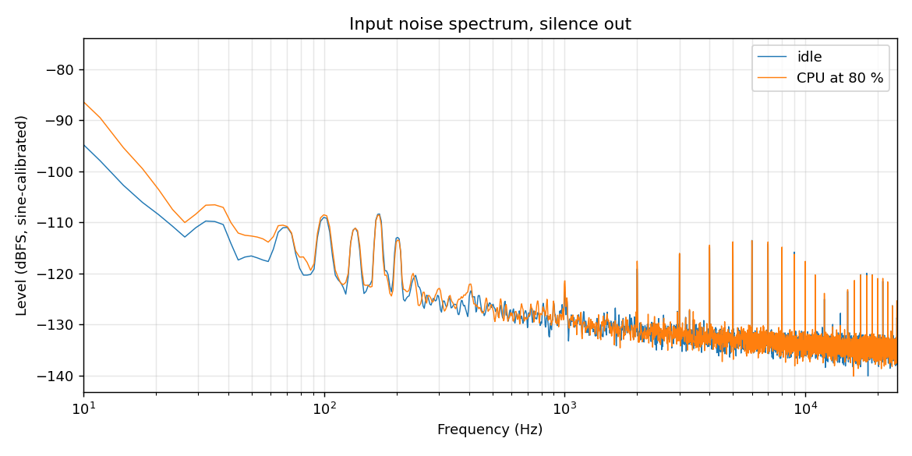
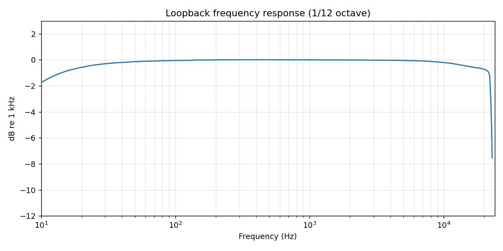
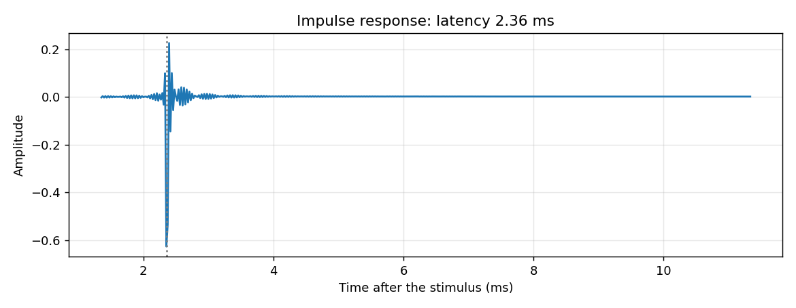
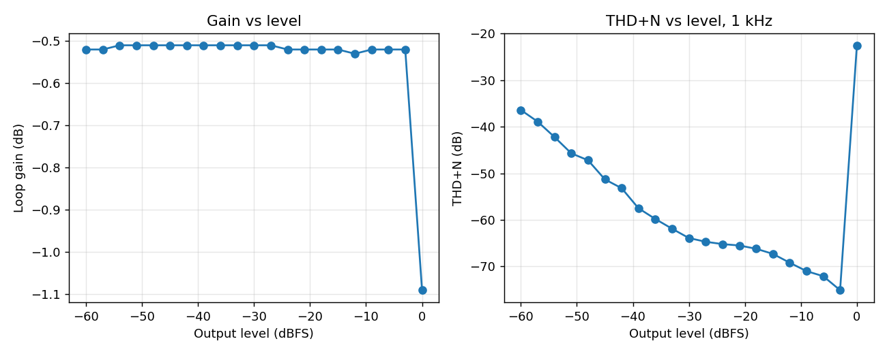

# Hardware test: rev1-board1

- **When:** 2026-11-17T14:08:47
- **Firmware commit:** 021e285
- **Device:** /dev/cu.usbmodem355F337734331 (proto=1, board=0, sr=48000, block=48, maxframes=960000, sdram=ok, sdram_fail_word=-1, sysclk_mhz=480)

**21 passed, 4 failed, 0 skipped.** Limits are in `hwtest/limits.json`.

| Check | Value | Limit | Result |
|---|---|---|---|
| Loopback cable found | True | = true | ✅ PASS |
| SDRAM self-test | ok | = "ok" | ✅ PASS |
| SNR, A-weighted | 99.4 | ≥ 90 dB | ✅ PASS |
| SNR, unweighted 20 Hz-20 kHz | 96.1 | ≥ 85 dB | ✅ PASS |
| Dynamic range (AES17), A-weighted | 99.6 | ≥ 90 dB | ✅ PASS |
| THD+N at -1 dBFS | -29.6 | ≤ -70 dB | ❌ FAIL |
| Idle noise, A-weighted | -100.2 | ≤ -90 dBFS | ✅ PASS |
| Mains hum | -109.1 | ≤ -100 dBFS | ✅ PASS |
| DC offset at the input | -9e-06 | |x| ≤ 0.01 FS | ✅ PASS |
| Noise increase under CPU load | 0.1 | ≤ 3 dB | ✅ PASS |
| Crosstalk between outputs | -97.1 | ≤ -60 dB | ✅ PASS |
| Gain linear from -60 to 0 dBFS | 0.58 | ≤ 0.5 dB | ❌ FAIL |
| No clipping up to 0 dBFS out | 0 | = null | ❌ FAIL |
| Response 40 Hz-15 kHz, low | -0.49 | ≥ -1 dB | ✅ PASS |
| Response 40 Hz-15 kHz, high | 0.01 | ≤ 1 dB | ✅ PASS |
| Round-trip latency | 2.361 | ≤ 5 ms | ✅ PASS |
| No dropouts in 12 s under load | 68 | ≤ 0 | ❌ FAIL |
| No overruns in the test firmware | 0 | ≤ 0 | ✅ PASS |
| Volume knob noise | 0.011 | ≤ 2 % travel | ✅ PASS |
| Tone knob noise | 0.014 | ≤ 2 % travel | ✅ PASS |
| Main firmware: every amp loads | 0 | ≤ 0 | ✅ PASS |
| Main firmware: worst callback | 582 | ≤ 950 us | ✅ PASS |
| Main firmware: overruns | 0 | ≤ 0 | ✅ PASS |
| Main firmware: no allocations in the audio callback | 0 | ≤ 0 | ✅ PASS |
| Main firmware: model switches | 0 | ≤ 0 | ✅ PASS |

## Setup found

Loopback found: output L → input L, loop gain -0.61 dB.
Gains (dB): outL_to_inL -0.6, outL_to_inR -81.2, outR_to_inL -97.7, outR_to_inR -115.5

## Noise

Idle: -96.9 dBFS unweighted, -100.2 dBFS A-weighted, DC -9e-06 FS. With the CPU at 80 %: -100.1 dBFS A-weighted (+0.1 dB).
Strongest mains line: -109.1 dBFS at 100.0 Hz.

Spurs (idle):

- 169.9 Hz at -108.4 dBFS (12.0 dB above the floor)
- 5997.1 Hz at -113.5 dBFS (19.3 dB above the floor)
- 6999.0 Hz at -114.2 dBFS (19.3 dB above the floor)
- 4998.0 Hz at -114.3 dBFS (18.2 dB above the floor)
- 3999.0 Hz at -114.9 dBFS (17.3 dB above the floor)
- 7998.0 Hz at -115.1 dBFS (18.7 dB above the floor)
- 8997.1 Hz at -115.8 dBFS (17.4 dB above the floor)
- 3000.0 Hz at -116.2 dBFS (15.2 dB above the floor)

## SNR and distortion

Full-scale output arrives at -0.75 dBFS. SNR 96.1 dB unweighted, 99.4 dB A-weighted; dynamic range 99.6 dB (AES17).
At -1 dBFS: THD+N -29.6 dB (3.2941 %), THD -29.7 dB, harmonics 2-6: [-34.7, -35.6, -37.0, -38.9, -41.4] dBc.

## Frequency response and latency

Latency 2.361 ms (113.35 samples), polarity inverted. -3 dB corners: 6.5918 Hz and 22447.3 Hz. Deviation 20 Hz-20 kHz: [-0.72, 0.01] dB; 40 Hz-15 kHz: [-0.49, 0.01] dB.

## Continuity

68 glitches in 12.0 s with the CPU at 80 % (residual -63.0 dBFS, threshold -48.0 dBFS).

## Knobs

- volume: at 99.99 %, noise 0.002 % rms, 0.011 % peak to peak (1.1 LSB rms)
- tone: at 99.99 %, noise 0.002 % rms, 0.014 % peak to peak (1.3 LSB rms)

Test firmware callbacks: 40184, worst 801 us, 0 overruns.

## Main firmware

| Mode | Avg (us) | Peak (us) | Headroom (us) | Overruns |
|---|---|---|---|---|
| bypass | 7 | 7 | 993 | 0 |
| Fender Twin65 | 569 | 581 | 419 | 0 |
| Vox AC30 Chimey | 570 | 582 | 418 | 0 |
| Marshall JCM800 G5 | 570 | 579 | 421 | 0 |
| Fender Princeton65 EOB | 557 | 566 | 434 | 0 |
| Randall Satan 50 | 556 | 566 | 434 | 0 |

30 model switches, 0 failed; slowest 0.003 s as seen from the host.

## Plots

Captures (stimulus and recording, 32-bit float WAV) are in `captures/`.
