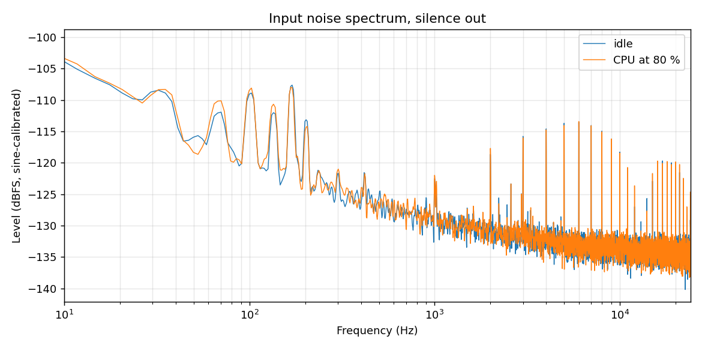
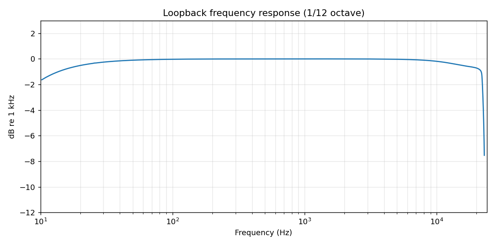
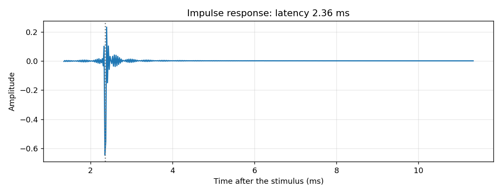
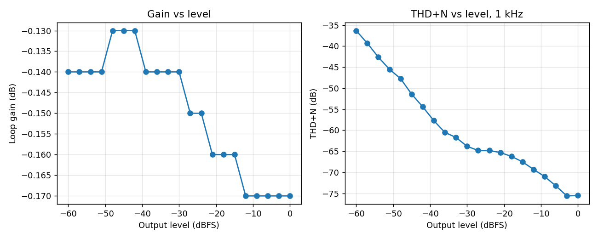

# Hardware test: 2026-11-17T14:44:21

- **When:** 2026-11-17T14:44:21
- **Firmware commit:** 021e285-dirty
- **Device:** /dev/cu.usbmodem355F337734331 (proto=1, board=0, sr=48000, block=48, maxframes=960000, sdram=ok, sdram_fail_word=-1, sysclk_mhz=480)

**25 passed, 0 failed, 0 skipped.** Limits are in `hwtest/limits.json`.

| Check | Value | Limit | Result |
|---|---|---|---|
| Loopback cable found | True | = true | ✅ PASS |
| SDRAM self-test | ok | = "ok" | ✅ PASS |
| SNR, A-weighted | 99.7 | ≥ 90 dB | ✅ PASS |
| SNR, unweighted 20 Hz-20 kHz | 96.5 | ≥ 85 dB | ✅ PASS |
| Dynamic range (AES17), A-weighted | 99.8 | ≥ 90 dB | ✅ PASS |
| THD+N at -1 dBFS | -77.7 | ≤ -70 dB | ✅ PASS |
| Idle noise, A-weighted | -99.9 | ≤ -90 dBFS | ✅ PASS |
| Mains hum | -108.4 | ≤ -100 dBFS | ✅ PASS |
| DC offset at the input | -1e-06 | |x| ≤ 0.01 FS | ✅ PASS |
| Noise increase under CPU load | 0 | ≤ 3 dB | ✅ PASS |
| Crosstalk between outputs | -95.6 | ≤ -60 dB | ✅ PASS |
| Gain linear from -60 to 0 dBFS | 0.04 | ≤ 0.5 dB | ✅ PASS |
| No clipping up to 0 dBFS out | none | = null | ✅ PASS |
| Response 40 Hz-15 kHz, low | -0.48 | ≥ -1 dB | ✅ PASS |
| Response 40 Hz-15 kHz, high | 0 | ≤ 1 dB | ✅ PASS |
| Round-trip latency | 2.361 | ≤ 5 ms | ✅ PASS |
| No dropouts in 12 s under load | 0 | ≤ 0 | ✅ PASS |
| No overruns in the test firmware | 0 | ≤ 0 | ✅ PASS |
| Volume knob noise | 0.011 | ≤ 2 % travel | ✅ PASS |
| Tone knob noise | 0.018 | ≤ 2 % travel | ✅ PASS |
| Main firmware: every amp loads | 0 | ≤ 0 | ✅ PASS |
| Main firmware: worst callback | 581 | ≤ 950 us | ✅ PASS |
| Main firmware: overruns | 0 | ≤ 0 | ✅ PASS |
| Main firmware: no allocations in the audio callback | 0 | ≤ 0 | ✅ PASS |
| Main firmware: model switches | 0 | ≤ 0 | ✅ PASS |

## Setup found

Loopback found: output L → input L, loop gain -0.17 dB.
Gains (dB): outL_to_inL -0.2, outL_to_inR -84.1, outR_to_inL -95.7, outR_to_inR -117.0

## Noise

Idle: -96.7 dBFS unweighted, -99.9 dBFS A-weighted, DC -1e-06 FS. With the CPU at 80 %: -99.9 dBFS A-weighted (+0.0 dB).
Strongest mains line: -108.4 dBFS at 180.0 Hz.

Spurs (idle):

- 169.9 Hz at -107.6 dBFS (13.0 dB above the floor)
- 6000.0 Hz at -113.5 dBFS (19.2 dB above the floor)
- 4998.0 Hz at -113.7 dBFS (19.0 dB above the floor)
- 6999.0 Hz at -114.1 dBFS (18.9 dB above the floor)
- 3999.0 Hz at -114.6 dBFS (17.4 dB above the floor)
- 7998.0 Hz at -115.0 dBFS (18.2 dB above the floor)
- 2997.1 Hz at -115.8 dBFS (15.5 dB above the floor)
- 8997.1 Hz at -116.4 dBFS (17.3 dB above the floor)

## SNR and distortion

Full-scale output arrives at -0.17 dBFS. SNR 96.5 dB unweighted, 99.7 dB A-weighted; dynamic range 99.8 dB (AES17).
At -1 dBFS: THD+N -77.7 dB (0.0131 %), THD -78.5 dB, harmonics 2-6: [-86.4, -83.8, -88.2, -85.0, -100.1] dBc.

## Frequency response and latency

Latency 2.361 ms (113.35 samples), polarity inverted. -3 dB corners: 6.5918 Hz and 22448.7 Hz. Deviation 20 Hz-20 kHz: [-0.71, 0.0] dB; 40 Hz-15 kHz: [-0.48, 0.0] dB.

## Continuity

0 glitches in 12.0 s with the CPU at 80 % (residual -88.7 dBFS, threshold -60.0 dBFS).

## Knobs

- volume: at 99.99 %, noise 0.002 % rms, 0.011 % peak to peak (1.1 LSB rms)
- tone: at 99.99 %, noise 0.002 % rms, 0.018 % peak to peak (1.5 LSB rms)

Test firmware callbacks: 40184, worst 801 us, 0 overruns.

## Main firmware

| Mode | Avg (us) | Peak (us) | Headroom (us) | Overruns |
|---|---|---|---|---|
| Fender Twin65 | 570 | 579 | 421 | 0 |
| Vox AC30 Chimey | 570 | 580 | 420 | 0 |
| Marshall JCM800 G5 | 570 | 581 | 419 | 0 |
| Fender Princeton65 EOB | 557 | 568 | 432 | 0 |
| Randall Satan 50 | 557 | 568 | 432 | 0 |
| bypass | 7 | 7 | 993 | 0 |

30 model switches, 0 failed; slowest 0.003 s as seen from the host.

## Plots

Captures (stimulus and recording, 32-bit float WAV) are in `captures/`.
